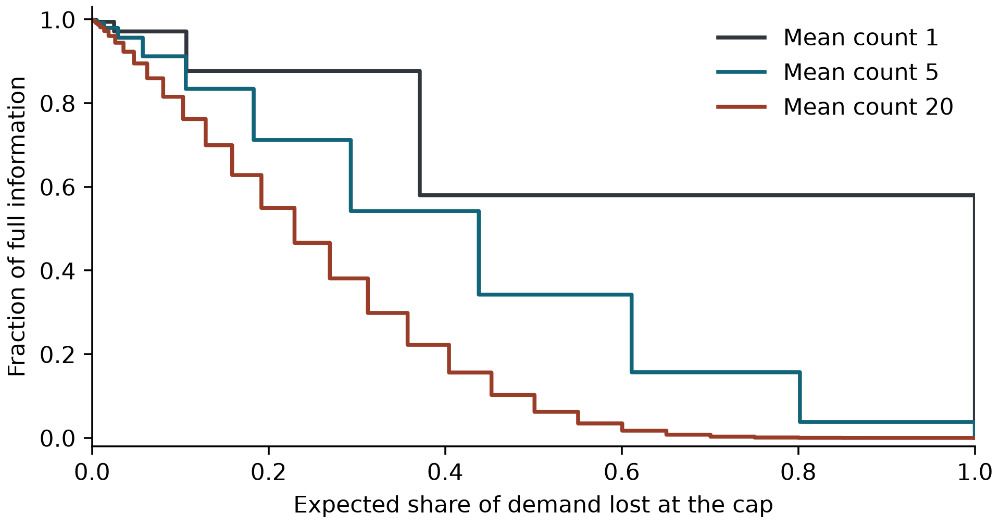

# What Hourly Stockout Records Reveal About Retail Demand

## Abstract

An hour without stock can remove very different amounts of demand at opening time and at peak trading time. We examine what hourly availability records can tell us about both the precision of a demand-level estimate and the value of reconstructing a sales history. We derive Fisher information for two observation mechanisms with the same expected lost share, a daily stock cap and independent thinning of purchases. Applied to 1,500 high-volume FreshRetailNet-50K store–product series, the inferred number of effective days depends on the assumed count scale and observation mechanism. We assess the empirical value of hourly records by applying historical stockout patterns to 5,711 fully stocked days with observable sales. Weighting unavailable hours by their usual share of sales reduces reconstruction error from 12.61% to 11.16%. On the official forecast week, volume-weighted Tobit reconstruction reduces weighted absolute percentage error from 23.42% for raw sales to 20.46%, with aggregate bias of −0.33%. It also improves on raw sales in the preceding week, although interpolation is more accurate there. Hourly records help locate missing volume; the resulting gain in forecast accuracy depends on the comparison method and evaluation window.

**Keywords**: censored demand; Fisher information; negative binomial distribution; stockout severity; retail forecasting; quantile loss

## 1. Introduction

A store can sell the same daily quantity in two quite different circumstances. One product sells steadily until closing; another sells out before the busiest hour. The daily sales total obscures this distinction. An hourly stock log identifies when the second product was unavailable, but customers who left without buying do not appear in the transaction record. The practical question is how much of that gap the timing of a stockout can explain.

Research on lost-sales inventory models established how a known stock limit enters a censored-demand likelihood [1]. FreshRetailNet-50K makes a different observation available at scale: it records hourly sales and stock status for 50,000 store–product series. Wang et al. used those records to recover latent demand before fitting a forecaster [2]. Azar compared recovery and forecast calibration in a forecast-to-inventory pipeline and reported the distinction between sales-based operating metrics and latent-demand profit [3]. Yin et al. evaluated hourly recovery using stockout flags, lower-bound constraints and controlled re-censoring [4]. These studies provide evidence for reconstruction. Their aggregate forecasting results cannot determine how much the clock time of an interruption adds beyond its duration.

We study that narrower question in two stages. First, we express information about a constant demand level in equivalent fully observed days. Two explicit observation mechanisms show why the same expected lost share need not imply the same information loss. Second, we use historical interruption patterns to hide sales on previously fully stocked days. This permits a direct comparison of hour-count and volume-weighted corrections against an observable target. We then ask whether that difference persists after the reconstructed history has passed through a forecaster and an inventory rule. We keep the three outcomes in their natural units: relative standard error for a level, absolute forecast error relative to sales volume, and a cost index for an inventory scenario.

## 2. Information about a demand level

### 2.1 Observing a daily stock cap

Let independent daily demands $D_t$ have the negative binomial distribution NB2 with fixed mean $\mu>0$, known size $k>0$ and variance $V=\mu+\mu^2/k$. A fully observed count $d$ has score $U(d)=(d-\mu)/V$ for $\mu$ and information $I_0=1/V$. Suppose a known cap $c$ is set before demand is realized, and only $Y=\min(D,c)$ is observed. We condition on the cap and hold it fixed when differentiating the likelihood. Fixed exogenous caps permit this calculation; inventories responding to unobserved demand signals would require a joint observation model.

Write $p_d=P(D=d)$, $m=\lceil c\rceil$ and $T_m=P(D\ge m)$. For $0<c<\infty$, counts below $m$ are distinguished and the remaining counts generate one outcome. Its score is the conditional expectation of the complete-data score. Hence the information in the observation is

$$
I_c=\sum_{d=0}^{m-1}p_d U(d)^2+
       \frac{\left(\sum_{d=m}^{\infty}p_d U(d)\right)^2}{T_m}.
$$

The missing-information identity [5] gives a useful interpretation. The loss $I_0-I_c$ equals $T_m\,\mathrm{Var}(U(D)\mid D\ge m)$. Even if a stockout is frequent, its information cost depends on how much the unobserved counts differ within the pooled tail. Lowering the cap merges previously distinguishable outcomes, so information can only decrease. In particular, a cap of 2.4 reveals a count of two exactly and pools counts of three or more. The ceiling operation matters for slow-moving products. We set $I_c=0$ at $c=0$ and $I_c=I_0$ in the absence of a cap.

To compare days at the same *expected* lost share $s$, choose a reference cap satisfying $E[\min(D,c)]=(1-s)\mu$. Such a cap exists and is unique for $0<s<1$: the left side is the integral of $P(D>x)$ from zero to $c$, which increases continuously to $\mu$. At integer $j$, it equals $\sum_{u=1}^jP(D\ge u)$. Searching these partial sums yields the first pooled integer directly. The reference cap depends on the chosen parameter value; the likelihood derivative above still describes a fixed-cap experiment.

At $s=0.32$ and $k=60$, the retained fraction $I_c/I_0$ is 0.877 for a mean count of 1, 0.542 for a mean of 5 and 0.299 for a mean of 20 (Figure 1). For the low-count process a positive cap still distinguishes a zero from a positive day. At a higher mean, many different positive counts can produce the same capped sale. A lost-volume percentage alone therefore cannot specify a retained-information percentage.

### 2.2 Observing independently thinned purchases

A second experiment assigns each of the day's $D$ units an independent probability $a=1-s$ of being observed. Conditional on $D$, the recorded quantity is binomial with parameters $D$ and $a$. This represents exogenous unavailability when purchase times are independent given the day's intensity and the available hours contain a known share $a$ of that intensity. A stockout triggered by a burst of purchases would violate this assumption.

The Poisson–gamma representation of NB2 gives the information in closed form. Thinning multiplies the conditional Poisson rate by $a$, preserving the gamma shape $k$. The observed count therefore has mean $a\mu$ and variance $a\mu+(a\mu)^2/k$. Applying the chain rule to its score gives the retention ratio

$$
\rho_{\mathrm{thin}}=\frac{a(1+\mu/k)}{1+a\mu/k}.
$$

Both mechanisms preserve an expected fraction $a$ of sales. They partition the possible observations differently. With a Poisson limit, thinning retains fraction $a$ of the full information, whereas cap retention still depends on the count level. At $s=0.32$, $\mu=20$ and $k=60$, thinning retains about 0.739 of the information, compared with 0.299 under the cap. Observing the same sales fraction does not identify which experiment generated it.

### 2.3 Effective days and the estimand

For either mechanism let $\rho_t$ denote retention on day $t$. Independent observations have additive Fisher information because their scores have mean zero and their cross-products have mean zero. The sum $n_{\mathrm{eff}}=\sum_t\rho_t$ is thus the number of fully observed days with the same Fisher information. For a regular unbiased estimator of this series' constant mean, the Cramér–Rao inequality [6] gives

$$
\frac{\mathrm{sd}(\widehat\mu)}{\mu}\ \ge\
\sqrt{\frac{1/\mu+1/k}{n_{\mathrm{eff}}}}.
$$

This inequality compares local precision in a specified experiment. Forecasts of future days have an additional source of variation even when the mean is known. Forecast features can also explain changes in demand that the constant-level experiment excludes. We therefore measure forecast loss on future observations separately. Borrowing information across products, estimating an unknown dispersion or inferring an endogenous stock policy changes the experiment.

## 3. Data and evaluation

### 3.1 Sampling and availability

The public data contain 90 training days from 28 March to 25 June 2024 and an official evaluation week from 26 June to 2 July. Sales are globally scaled quantities; the release identifies no physical conversion coefficient [2,7]. For each forecast origin we ranked store–product series by cumulative observed sales through that origin, then sampled 1,500 without replacement from the top 4,000 using seed 0. The official sample includes 609 stores, 77 products, 17 cities and 16 first-level product categories. A unit of analysis is a product at a particular store. Ranking by sales selects commercially active series and also depends on availability.

A training day is flagged when any hour from 06:00 to 22:00 (end exclusive) is out of stock. For each series, we summed sales separately by hour across unflagged training days and divided by the total over all 24 hours. We used the pooled hourly profile when a series had fewer than five unflagged days or no sales on those days. The volume-weighted severity is the sum of the profile weights of flagged business hours. The duration measure is the number of flagged hours divided by 16. Across the official training panel, 52.68% of days were flagged. On flagged days the mean volume-weighted share was 0.318, compared with a mean duration share of 0.388. These are proxies for exposure. Lost sales are unobserved on naturally flagged days.

For the information scenarios, we set $\mu$ to the mean sales on unflagged training days multiplied by an assumed number of count units per released sales unit. Multipliers 1 and 10 illustrate the dependence on the unpublished conversion. We varied $k$ between 10, 60 and 2,000 and held each series' observed severity pattern fixed. These design calculations use a plug-in mean and an estimated hourly profile. They do not include the uncertainty in either input.

### 3.2 A reconstruction check with known hourly sales

We took each fully stocked day in the official evaluation week and drew one flagged day from the same series' training history. We hid the evaluation day's sales in the business hours flagged on the drawn day. The sum of the 24 original hourly sales is then a known reconstruction target. This preserves actual within-day stockout patterns while making their assignment independent of the evaluation day's demand conditional on series. We repeated the assignment 20 times with seed 2026 and kept all repetitions for a series together.

Let $L_i$ be series $i$'s mean sales on fully stocked training days, $B$ the hidden business hours and $Y_{\rm vis}$ the day's remaining sales. The duration version restores $L_i|B|/16$ to $Y_{\rm vis}$; the profile version restores $L_i\sum_{h\in B}w_{ih}$, where $w_{ih}$ is the training share for hour $h$. Both use exactly the same sales level, dates and masks. A zero-correction baseline keeps $Y_{\rm vis}$. We sum absolute errors and divide by total original volume, averaging across mask draws. The design tests a component of reconstruction on days for which ground truth exists. It does not recreate the dependence of genuine stockouts on unexpectedly strong demand.

### 3.3 Forecasts, paired comparisons and ordering

Five histories enter the same forecasting procedure. The first uses reported sales throughout. The second interpolates linearly between fully stocked days, extending the nearest observed value at either end. The remaining three use Gaussian Tobit-style reconstruction [8]. A per-series regression includes an intercept, a linear trend, two weekly sine–cosine pairs and a discount indicator. At a flagged observation $y$, the fit assigns weight $1-s$ to the exact-observation log density and weight $s$ to the log probability above $y$. Its working completed value blends $y$ with the Gaussian upper-tail mean using those same weights. This weighted criterion is a reconstruction heuristic. Its weights come from a binary flag ($s=1$ on every flagged day), duration, or the hourly volume profile. The NB2 information calculation and this Gaussian reconstruction serve different estimands.

For each of seven horizons we fitted a separate histogram gradient-boosted tree ensemble across series, using the reconstructed history for both lag features and training targets. The model used up to 50 boosting iterations, learning rate 0.10, up to 31 leaves, and seed 0. Inputs included sales lags through 28 days, rolling summaries, recent stockout frequency, time features, series identifier and scale, and the target-day discount indicator. The exercise conditions on the discount schedule being known at forecast time. All reconstruction and training used the history available at the forecast origin. Internal training examples share a retrospective reconstruction of that history.

We evaluated point forecasts on fully stocked business days. With error $e=\widehat y-y$, weighted absolute percentage error (WAPE) is $100\sum|e|/\sum y$, and signed aggregate bias is $100\sum e/\sum y$. Zero-sales observations contribute their errors. For a sensitivity check, we moved the forecast origin back seven days, repeating series selection, profile estimation, reconstruction and model fitting with 83 training days to predict 19–25 June. The two panels can differ. Both weeks had been available during manuscript development; comparisons are exploratory.

For paired uncertainty intervals, we resampled stores with replacement 2,000 times, retaining every series, date and prediction in a selected store. Each draw recomputes the ratio of summed paired error differences to summed sales. We also report intervals resampling products to assess dependence across stores selling the same product. The two sets of percentile intervals describe variation across one clustering dimension at a time, conditional on the fitted forecasts and dates. Neither resampling scheme estimates variation over future weeks. Intervals are pointwise across comparisons.

For the official week we also fitted quantile regressions with the same features at $\tau=0.50,0.90,0.98$. Their normalized pinball loss is $100\sum\max(\tau u,(\tau-1)u)/\sum y$, where $u=y-\widehat q_\tau$ [9,10]. In a one-period inventory problem with underage cost 1 and overage cost 0.02, the critical fractile is $1/1.02\approx0.98$. To examine the effect of lead time we replayed all seven days of *recorded sales* under a separate replenishment rule. The reorder point and target stock equaled 1.5 and 3 times the average of the seven daily quantile forecasts. Initial on-hand stock and the total already in transit each equaled the target. Arrivals were spread over three days. After each day's sales, the rule triggered on end-of-day stock and ordered the gap to target for delivery three days later, without netting outstanding orders. We charged 0.02 per unit of closing inventory per day and 1 per unfilled unit. This is a short simulation on a fixed sales path, including flagged days, with policy-dependent starting stock.

## 4. Results

### 4.1 Sensitivity of the level-information calculation

The median series had 44 fully stocked days in the 90-day history. Partially observed days contributed additional information in every scenario (Table 1). At scale 1 and size 60, the cap and thinning experiments yield nearly identical median precision bounds. At scale 10 and the same size, effective days diverge by more than 15 days, even though both experiments use exactly the same hourly stock records. Under the cap, a larger count scale can reduce the effective day count while improving relative precision because a clean high-count day is itself more informative in relative terms.

Table 1. Median effective days and lower bounds on relative standard error (RSE) of an unbiased level estimate. Each entry is a median over 1,500 series, calculated after evaluating each series at its own mean and availability profile.

| Count scale | Size $k$ | Cap days | Cap RSE (%) | Thinning days | Thinning RSE (%) |
|---:|---:|---:|---:|---:|---:|
| 1 | 10 | 76.52 | 7.41 | 78.27 | 7.32 |
| 1 | 60 | 75.98 | 6.65 | 76.74 | 6.61 |
| 1 | 2,000 | 75.87 | 6.49 | 76.38 | 6.47 |
| 10 | 10 | 69.24 | 4.39 | 84.13 | 3.98 |
| 10 | 60 | 63.89 | 2.78 | 79.22 | 2.48 |
| 10 | 2,000 | 61.55 | 2.30 | 76.50 | 2.06 |

### 4.2 How much does stockout timing explain?

Across the 5,711 fully stocked evaluation days, the imposed masks hid 33.98% of hourly sales volume on average in aggregate. Restoring the typical volume of an average business hour reduced reconstruction WAPE to 12.61%. Giving the same hours their own historical weights reduced it further to 11.16%. The paired difference of −1.45 points had a store-clustered 95% interval of [−1.68, −1.22] and a product-clustered interval of [−2.77, −0.67]. The profile correction still underestimated volume by 3.33% in aggregate. Locating the hours of the interruption improves reconstruction even when both corrections use the same estimate of the typical day's level. The remaining shortfall can include differences between the evaluation day's sales and that training level.

### 4.3 Forecast accuracy across two weeks

On the official week, all 1,500 series contributed a fully stocked day and 1,498 contributed positive sales on those days. Duration weighting produced the lowest WAPE in this comparison; volume weighting produced the smallest absolute signed bias (Table 2). Giving every flagged day full censoring weight brought the official-week bias to +10.56%, overshooting the correction needed for partially available days. On the earlier week, 1,420 series contributed 5,530 fully stocked observations. Interpolation then gave the lowest WAPE; even the profile correction underforecast by 8.44%. A near-zero aggregate bias in the official week therefore does not establish persistent calibration.

Table 2. Point forecasts on fully stocked evaluation days. All values are percentages. Both panels contain 1,500 training series selected separately at their forecast origins.

| Training history | Official WAPE | Official bias | Earlier WAPE | Earlier bias |
|:---|---:|---:|---:|---:|
| Reported sales | 23.42 | −7.11 | 29.73 | −14.74 |
| Linear interpolation | 21.14 | +1.30 | 24.65 | −9.04 |
| Binary Tobit | 23.26 | +10.56 | 25.87 | +3.75 |
| Duration-weighted Tobit | 20.41 | +0.92 | 25.06 | −7.70 |
| Volume-weighted Tobit | 20.46 | −0.33 | 25.60 | −8.44 |

The gain over reported sales appeared in both windows and under both cluster definitions (Table 3). The smaller gain over interpolation on the official week changed sign in the preceding week, and the product-clustered intervals included zero on both dates. Compared with duration weighting, the better reconstruction of artificially hidden hours did not translate into a lower forecast WAPE in either week. Reconstruction accuracy and forecast bias each reveal something that the ranking by WAPE misses.

Table 3. Paired WAPE differences in percentage points, volume-weighted Tobit minus the named comparator. Brackets give 95% percentile intervals.

| Evaluation week | Comparator | Difference | By store | By product |
|:---|:---|---:|:---|:---|
| Official | Reported sales | −2.96 | [−3.36, −2.55] | [−5.19, −0.94] |
| Official | Interpolation | −0.68 | [−1.13, −0.23] | [−1.96, +0.25] |
| Official | Duration weighting | +0.05 | [−0.12, +0.23] | [−0.82, +0.49] |
| Earlier | Reported sales | −4.13 | [−4.53, −3.74] | [−5.76, −2.34] |
| Earlier | Interpolation | +0.95 | [+0.38, +1.51] | [−1.10, +2.67] |
| Earlier | Duration weighting | +0.54 | [+0.39, +0.70] | [+0.15, +0.82] |

A geographic breakdown gives some indication of how the panel average was formed. The largest city contained 867 of the 1,500 series; its official-week difference versus reported sales was −3.30 points. The two next-largest cities had differences of −2.45 (158 series) and −4.43 (145 series). In the four largest first-level categories, the differences ranged from −8.63 to −0.88 points. One smaller category, with 32 series, reversed the direction (+5.24). The supplement gives every subgroup, including those too small to support a stable comparison.

### 4.4 Forecasting upper quantiles and replaying an order rule

For all three quantiles, the volume-weighted history yielded the lowest pinball loss among the three histories examined (Table 4). At the median, interpolation also improved on raw sales. At the 0.98 quantile, interpolation increased loss by 5.3% relative to raw sales, whereas volume weighting reduced it by 8.7%. Thus two histories that gave similar absolute errors for point forecasts can behave differently in the upper tail.

Table 4. Official-week normalized pinball loss on fully stocked days and simulated outcomes on the entire recorded-sales path. Shortfall is in released sales units. The cost index combines shortage and holding charges.

| History | Quantile | Pinball | Shortfall | Cost index |
|:---|---:|---:|---:|---:|
| Reported sales | 0.50 | 11.35 | 6,139 | 7,957 |
| Reported sales | 0.90 | 5.78 | 1,186 | 4,815 |
| Reported sales | 0.98 | 1.96 | 365 | 5,533 |
| Interpolation | 0.50 | 10.82 | 5,408 | 7,439 |
| Interpolation | 0.90 | 5.83 | 1,424 | 5,141 |
| Interpolation | 0.98 | 2.06 | 465 | 5,678 |
| Volume-weighted Tobit | 0.50 | 10.52 | 5,507 | 7,470 |
| Volume-weighted Tobit | 0.90 | 5.33 | 1,025 | 4,650 |
| Volume-weighted Tobit | 0.98 | 1.79 | 329 | 5,517 |

Moving from the median to the 0.98 quantile cut simulated shortfall sharply in every history, as the higher forecasts also supplied more inventory. For volume weighting, the shortfall fell from 5,507 to 329. The 0.90 policy, however, had a lower total cost than 0.98 for all three histories. In the volume-weighted case the extra holding charge outweighed the reduction from 1,025 to 329 unfilled units. A one-period critical fractile alone cannot determine which quantile to feed this multi-period rule.

## 5. Discussion

The clearest evidence for the hourly record comes from the masking experiment. Suppose a system already records the number of unavailable hours. Adding their clock times gives a measurable improvement in estimating the hidden volume of otherwise observable days, using the same level estimate. The distinction becomes smaller in a pooled forecasting model. Daily reconstruction changes both the lagged predictors and the labels used to fit the trees. A smaller imputation error on one day need not translate into a smaller absolute error several days ahead. A planner choosing between the two histories would obtain different answers from the official-week signed bias, point WAPE and upper-quantile loss.

The information calculation clarifies what additional records would make a precision statement interpretable. A known inventory cap distinguishes low counts exactly and groups the upper tail. An available-time fraction tells us how often a purchase can be seen, but an analyst must still specify how purchases arrive within the available hours. Releasing opening stock, replenishment times and a count-unit conversion would permit closer calibration of these two mechanisms. Without them, the contrast in Table 1 is informative precisely because both scenarios agree on the expected share of lost sales.

Three features constrain generalization. First, the evaluation observes realized demand most clearly on stocked days. Busy days that sell out may have different arrival patterns, and substitution or customer deferral can affect even fully stocked sales. Artificial masking recovers known hourly totals under independent reassignment; external validity for naturally missing transactions remains open. Second, both forecasting windows cover adjacent weeks in one high-volume sample design. Resampling stores or products exposes cross-sectional heterogeneity but cannot capture new seasons, pricing regimes or product launches. The 77 distinct products in the official panel also explain why product-based intervals can be substantially wider. Third, the inventory replay starts with policy-specific stock, uses censored sales as a demand proxy and omits spoilage. It identifies mechanical trade-offs in a given scenario. Operational savings would require a longer decision horizon and an independently validated demand measure.

## 6. Conclusions

The timing of a stockout helped estimate the sales hidden by a known interruption. On days with observed hourly truth, a volume-weighted correction lowered reconstruction WAPE by 1.45 points relative to counting unavailable hours. Reconstructing the training history also improved on raw-sales forecasting in two consecutive weeks, while the ranking relative to interpolation depended on the week. For demand-level inference, a stockout log supports a range of precision estimates conditional on the unit scale and observation model. Reporting these assumptions alongside reconstruction error, signed bias and the loss relevant to ordering gives each result a testable interpretation.

## Data and reproducibility

FreshRetailNet-50K is distributed by Dingdong-Inc under CC BY 4.0 [2,7]. The accompanying replication archive provides the analysis programs, environment versions, input hashes and full numerical outputs, including all city and category contrasts. The analyses use the public training and evaluation files. Only store–product records and aggregate sales enter the analysis.

**Use of generative AI.** OpenAI Codex assisted with manuscript revision, checking mathematical expressions, preparing analysis code and organizing results.

## References

[1] Nahmias, S. Demand estimation in lost sales inventory systems. *Naval Research Logistics* 1994, 41, 739–757.

[2] Wang, Y.; Gu, J.; Long, L.; Li, X.; Shen, L.; Fu, Z.; Zhou, X.; Jiang, X. FreshRetailNet-50K: A stockout-annotated censored demand dataset for latent demand recovery and forecasting in fresh retail. *arXiv* 2025, 2505.16319. https://doi.org/10.48550/arXiv.2505.16319

[3] Azar, J. A reproducible, leakage-free pipeline for censored demand forecasting and inventory optimization on FreshRetailNet-50K. *Inventions* 2026, 11, 89. https://doi.org/10.3390/inventions11050089

[4] Yin, C.; Zheng, Y.; Kong, Z. Demand hidden by stockouts: Censored demand recovery and green waste-reduction forecasting for sustainable fresh-food consumption under emerging-market urbanization. *Sustainability* 2026, 18, 7642. https://doi.org/10.3390/su18157642

[5] Louis, T.A. Finding the observed information matrix when using the EM algorithm. *Journal of the Royal Statistical Society, Series B* 1982, 44, 226–233. https://doi.org/10.1111/j.2517-6161.1982.tb01203.x

[6] Lehmann, E.L.; Casella, G. *Theory of Point Estimation*, 2nd ed. Springer, New York, 1998. https://doi.org/10.1007/b98854

[7] Dingdong-Inc. *FreshRetailNet-50K*, version 1.0. Dataset and data dictionary, 2025. https://huggingface.co/datasets/Dingdong-Inc/FreshRetailNet-50K

[8] Tobin, J. Estimation of relationships for limited dependent variables. *Econometrica* 1958, 26, 24–36. https://doi.org/10.2307/1907382

[9] Koenker, R.; Bassett, G. Regression quantiles. *Econometrica* 1978, 46, 33–50. https://doi.org/10.2307/1913643

[10] Gneiting, T. Making and evaluating point forecasts. *Journal of the American Statistical Association* 2011, 106, 746–762. https://doi.org/10.1198/jasa.2011.r10138

